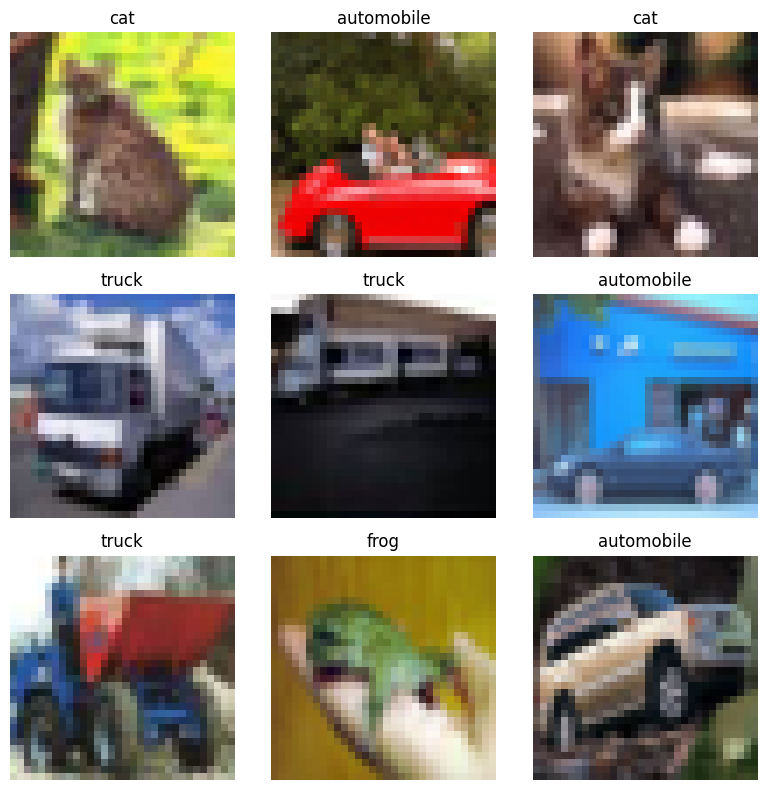
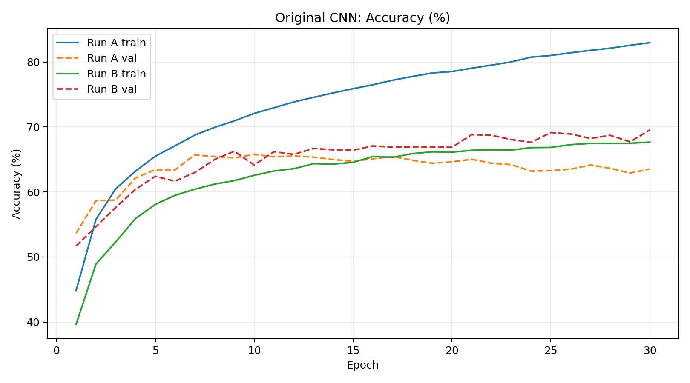
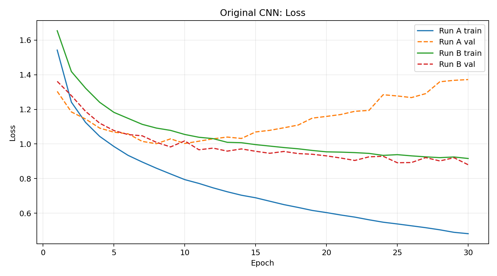
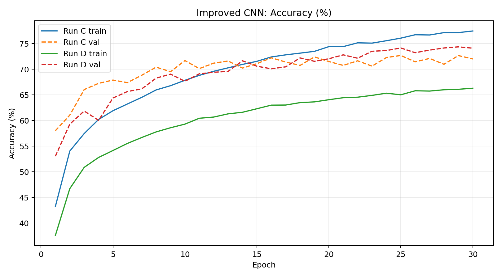
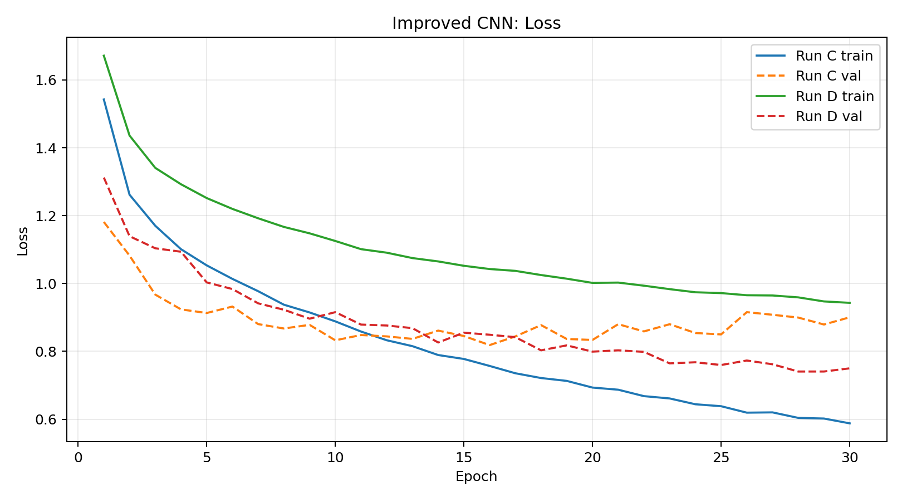
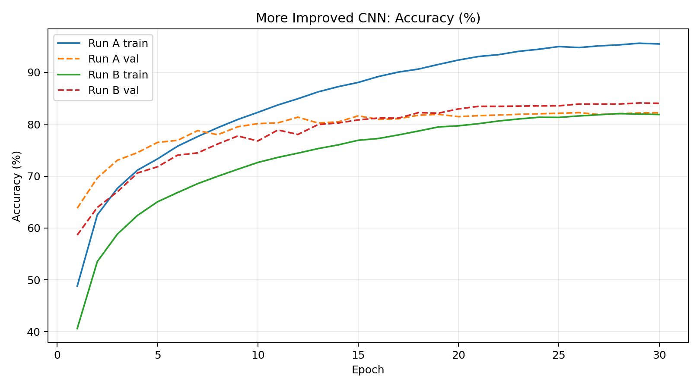
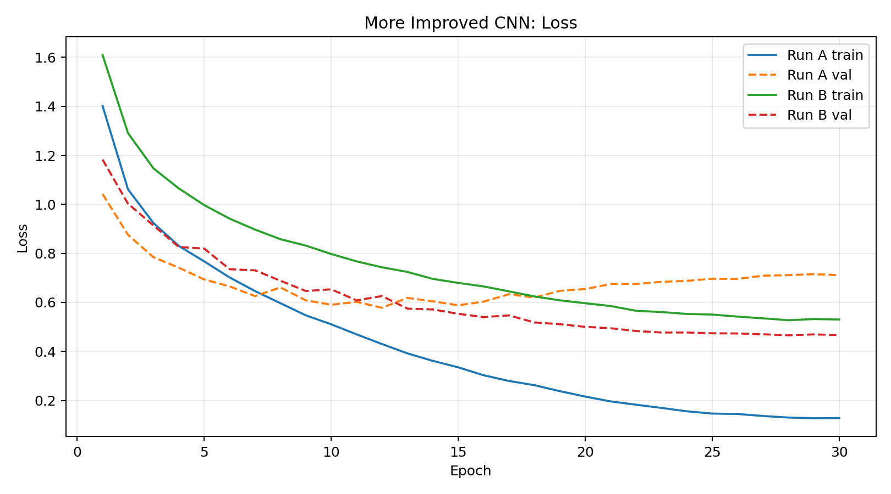
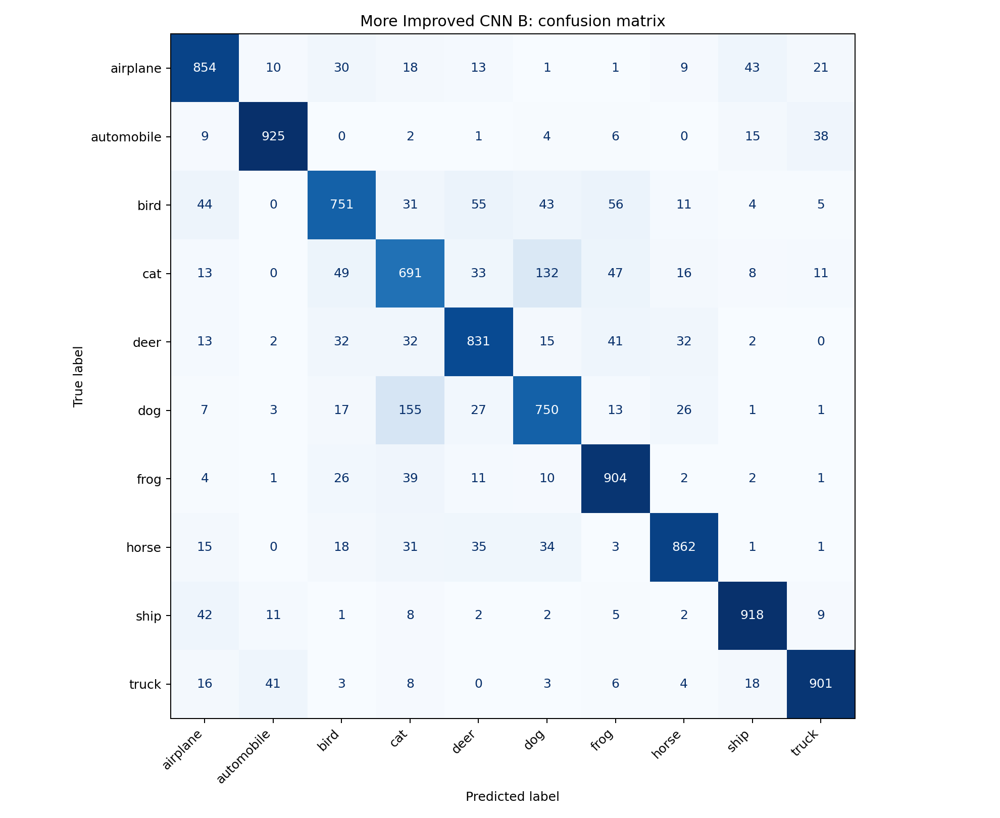
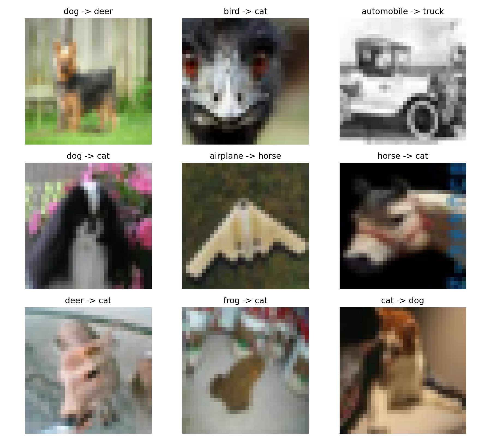

# Project Trailcam

The project file has **6 runs instead of the required 2**. This is because of my attempts to increase test accuracy and reduce overfitting, particularly in the runs without augmentation. I wasn't satisfied with the results of SimpleCNN, so I tried two additional architectures with progressively more changes.

Each architecture has two runs: one without augmentation and one with augmentation.

Here is a report of all three architectures:

### 1. SimpleCNN

**2 Convolutional Layers**

- **Conv1:** 3 → 8 channels | 32×32 → 32×32
- **Conv2:** 8 → 16 channels | 16×16 → 16×16
- Kernel size: 3×3, padding: 1
- ReLU: 3 times (2 convolutional, 1 fully connected)
- Max Pooling: 2 times
- Flatten: 16 × 8 × 8 → 1024 features
- Fully Connected: 1024 → 64 → 10
- Optimizer: Adam
- Learning rate: 0.001
- Trainable parameters: 67,642
- Epochs: 30

This was my initial architecture. It worked reasonably well, but the run without augmentation began overfitting after the earlier epochs.

### 2. ImprovedCNN

**2 Convolutional Layers**

- **Conv1:** 3 → 32 channels | 32×32 → 32×32
- **Conv2:** 32 → 64 channels | 16×16 → 16×16
- Kernel size: 3×3, padding: 1
- ReLU: 3 times (2 convolutional, 1 fully connected)
- Max Pooling: 2 times
- Batch Normalization: 2 times, after each convolution
- Flatten: 64 × 8 × 8 → 4096 features
- Fully Connected: 4096 → 64 → 10
- Dropout: 0.25
- Optimizer: Adam
- Learning rate: 0.001
- Trainable parameters: 282,442
- Epochs: 30

**Changes from SimpleCNN:**

- More convolutional filters (8, 16 → 32, 64)
- Batch normalization to make training more stable
- Dropout to reduce dependence on individual neurons
- Increased feature-extraction capacity

This version performed better than SimpleCNN in both runs, although the model without augmentation still showed signs of overfitting.

### 3. MoreImprovedCNN (Keeping the theme alive)

**4 Convolutional Layers**

- **Conv1:** 3 → 32 channels | 32×32 → 32×32
- **Conv2:** 32 → 64 channels | 16×16 → 16×16
- **Conv3:** 64 → 64 channels | 16×16 → 16×16
- **Conv4:** 64 → 128 channels | 8×8 → 8×8
- Kernel size: 3×3, padding: 1
- ReLU: 5 times (4 convolutional, 1 fully connected)
- Max Pooling: 3 times
- Batch Normalization: 4 times
- Dropout2d: 0.10
- Flatten: 128 × 4 × 4 → 2048 features
- Fully Connected: 2048 → 128 → 10
- Dropout: 0.35
- Optimizer: AdamW
- Initial learning rate: 0.001
- Weight decay: 0.0001
- Learning rate scheduler: CosineAnnealingLR
- Minimum learning rate: 0.00001
- Trainable parameters: 394,314
- Epochs: 30

**Changes from ImprovedCNN:**

- Two additional convolutional layers
- Additional feature extraction through the 64 → 64 convolution
- Increased output channels to 128
- Dropout2d to randomly disable entire feature channels during training
- Higher fully connected dropout for regularization
- AdamW with weight decay to discourage unnecessarily large weights
- Cosine annealing to gradually reduce the learning rate over 30 epochs

My aim with these changes was to improve feature extraction while controlling overfitting through regularization and learning-rate adjustments.

The results were considerably better, especially with augmentation.

---

## Some Key Points Before the Statistics

- I am a complete beginner in machine learning, so I uploaded the resources provided by ACM to GPT and asked it to teach me the concepts required for this task.

- The code was written with suggestions and explanations from GPT, along with external research performed by me because I wasn't satisfied with the initial accuracies. I wanted to experiment with different architectures rather than stop at the minimum requirements.

- The dataset used is still **CIFAR-10**. However, the original download was extremely slow, and I was concerned about Colab disconnecting during the process. I therefore used an alternative download source suggested by GPT, hosted on Hugging Face, containing the same CIFAR-10 Python dataset.

- GPT also helped me organize the implementation, including:

  - Using Dataloader for batching and shuffling.
  - Separating training, validation and testing.
  - Saving training histories in `.json` files.
  - Resuming interrupted training from saved checkpoints.

- All six runs were trained for 30 epochs. The augmented and unaugmented experiments within each architecture used the same training settings, with augmentation being the only difference.

### Sample images

### Normalization

All three architectures used RGB-channel normalization.

| Channel |   Mean | Standard deviation |
| ------- | -----: | -----------------: |
| Red     | 0.4914 |             0.2470 |
| Green   | 0.4822 |             0.2435 |
| Blue    | 0.4465 |             0.2616 |

### Augmentation

The augmented runs used:

- Random horizontal flip with probability 0.5
- Random 32×32 crop with padding of 4 pixels

The purpose was to expose the CNN to variations of the same training images, rather than having it repeatedly learn from only their original orientations and positions.

Augmentation was applied only during training, not during validation or testing.

---

## Final Accuracies

| Model           | Run | Augmentation | Best validation accuracy | Test accuracy |
| --------------- | --- | ------------ | -----------------------: | ------------: |
| SimpleCNN       | A   | No           |                   65.78% |        66.09% |
| SimpleCNN       | B   | Yes          |                   69.54% |        70.07% |
| ImprovedCNN     | C   | No           |                   72.70% |        73.33% |
| ImprovedCNN     | D   | Yes          |                   74.38% |        74.96% |
| MoreImprovedCNN | A   | No           |                   82.24% |        82.14% |
| MoreImprovedCNN | B   | Yes          |                   84.10% |    **83.87%** |

### Improvement from augmentation

| Architecture    | Increase in test accuracy |
| --------------- | ------------------------: |
| SimpleCNN       |   +3.98 percentage points |
| ImprovedCNN     |   +1.63 percentage points |
| MoreImprovedCNN |   +1.73 percentage points |

All three architectures performed better when trained with augmentation.

The highest test accuracy was **83.87%**, achieved by MoreImprovedCNN with augmentation.

---

## Accuracy and Loss Plots

### SimpleCNN

**Accuracy vs Epoch**

**Loss vs Epoch**

### ImprovedCNN

**Accuracy vs Epoch**

**Loss vs Epoch**

### MoreImprovedCNN

**Accuracy vs Epoch**

**Loss vs Epoch**

---

## Confusion Matrix

The confusion matrix was generated using **MoreImprovedCNN B**, which achieved the highest test accuracy.

### Most-Confused Classes: Cat and Dog

- Actual cats predicted as dogs: **132**
- Actual dogs predicted as cats: **155**
- Total confusion between the two classes: **287 images**

Cat was also the class with the most incorrect predictions overall (309 out of 1,000), followed by dog (250 out of 1,000).

This may be because cats and dogs share several features,including fur, ears and body shape. CIFAR-10's low image resolution makes fine details harder to distinguish.

### Misclassified Examples

---

## Field Report — Observations and Findings

### 1. Overfitting in SimpleCNN

This was particularly noticeable in Run A, which did not use augmentation.

At epoch 10:

- Training accuracy: 72.08%
- Validation accuracy: 65.78%

At epoch 30:

- Training accuracy: 82.97%
- Validation accuracy: 63.52%

Despite improving its training accuracy, the model performed worse on validation images. Its validation loss also increased from approximately 1.00 to 1.37.

This suggested that the model was increasingly memorizing rather than generalizing.

### 2. Effect of augmentation

Augmentation improved test accuracy in all three architectures.

In SimpleCNN, the improvement was especially noticeable: from 66.09% to 70.07%.

For MoreImprovedCNN, augmentation improved test accuracy from 82.14% to 83.87%.

The model without augmentation reached 95.48% training accuracy but only 82.22% validation accuracy by the final epoch.

In contrast, the augmented model finished with 81.88% training accuracy and 84.04% validation accuracy.

The lower training accuracy could be due to its training images being randomly transformed, and dropout was active during training, making the training task harder than validation.

### 3. Effect of architectural changes

Moving from SimpleCNN to ImprovedCNN increased the number of convolutional filters and introduced batch normalization and dropout.

MoreImprovedCNN added further convolutional layers, additional regularization and learning-rate scheduling.

The more advanced experiments achieved higher accuracies. However, because multiple changes were introduced together, the results don't isolate the effect of each individual technique.

### 4. Confusion matrix findings

Our best model correctly classified **8,387 of the 10,000 test images**, leaving 1,613 incorrect predictions.

The most common confusion was between cats and dogs. This suggests that distinguishing visually similar animal classes remains a challenge, even after improvements to the CNN.

### 5. Final observations

The main thing I observed was that increasing training accuracy alone doesn't guarantee better performance on unseen images.

My original CNN demonstrated this through overfitting, while augmentation consistently improved the test accuracy across all three architectures.

The final model reached 83.87% test accuracy, although the results are specific to CIFAR-10 and shouldn't be treated as an estimate of performance on actual wildlife-camera images.

Since these were exploratory experiments rather than repeated trials across several random seeds, the reported improvements describe the results of these particular training runs.

---

## Running the notebook

1. Install the dependencies with `pip install -r requirements.txt` or open [ACM_Trailcam.ipynb](ACM_Trailcam.ipynb) in Google Colab.
2. Keep the `checkpoints/` and `histories/` folders alongside the notebook. Set `TRAIN_MODELS = False` to load the saved models without retraining.
3. Run the notebook cells in order. The final cells generate accuracy/loss plots, test accuracy, the confusion matrix and misclassified examples.
4. To retrain deliberately, set `TRAIN_MODELS = True`; GPU runtime is recommended.

**Checkpoint upload note:** `checkpoints/run_D_best.pt` (ImprovedCNN, augmented run D) was not included in the initial GitHub upload because the file transfer was blocked. Until it is added to `checkpoints/`, the evaluation cell loading all six saved models will fail for run D. The checkpoint is saved in the original [project's Google Drive](https://drive.google.com/file/d/10EradSWqxFVkbSpzeEPGguJZPDNq0LoO/view) and can be downloaded and uploaded to this repository without modifying the test code.
